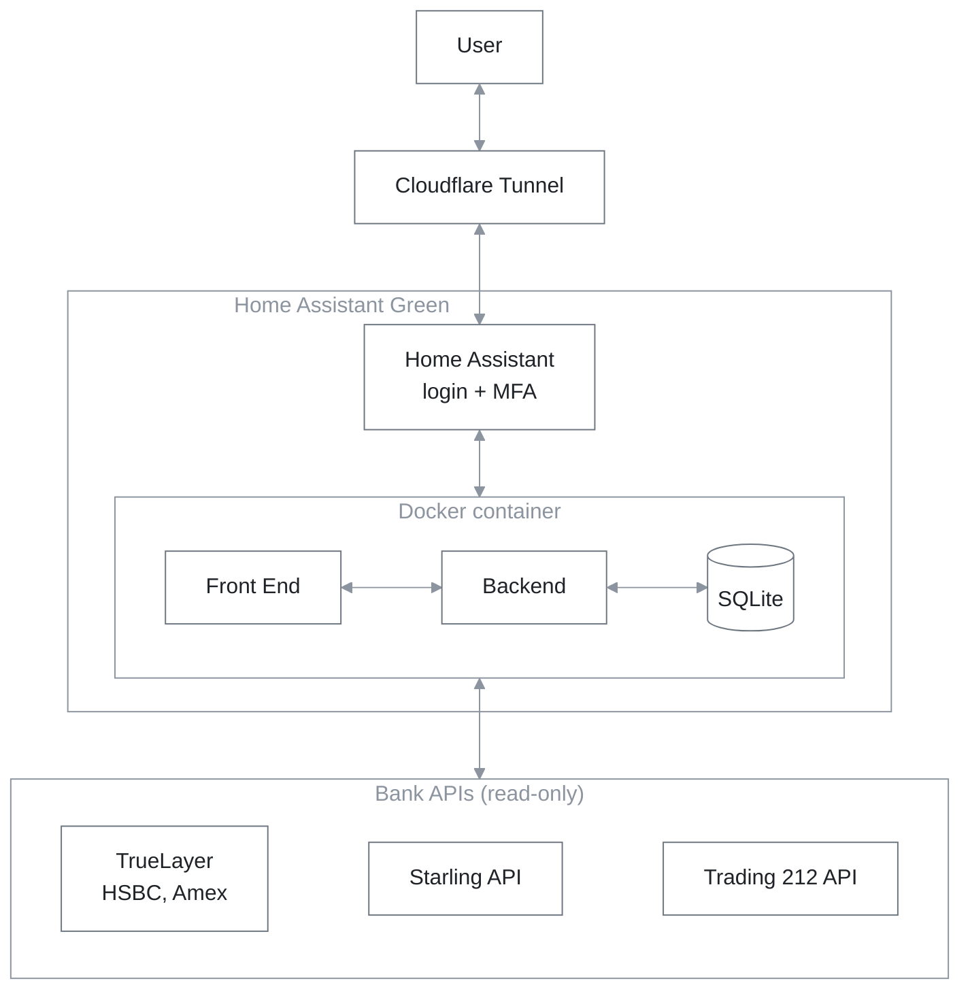

# Finance Dashboard

A vibe-coded personal finance dashboard, built to replace Emma and Snoop. It
brings my bank accounts, credit cards and investments together in one place,
for insight into spending, budgeting and investments. It's self-hosted at home
on a Home Assistant Green, a small Raspberry Pi.

## What it does

- **Spending:** where the money goes, by category and merchant, month by month.
- **Budgets:** monthly limits per category, and how this month is tracking.
- **Subscriptions and bills:** found automatically, with price rises,
  duplicates and stopped payments flagged.
- **Cash flow:** money in against money out, and a projection for the month.
- **Investments and net worth:** Trading 212 holdings, the pension and other
  assets, and a daily net-worth history.
- **Needs fixing:** plain-English findings, each with a pound figure attached.

## Architecture



Home Assistant OS runs everything as Docker containers, and the dashboard is
one of them, installed as a Home Assistant App. Inside it, a single Python
process does all the work:

| Part | Built with | Job |
|---|---|---|
| Backend | Python 3.12, FastAPI | The JSON API, and serves the web UI |
| Frontend | React, TypeScript, Vite, Recharts | The tabs and charts in the browser |
| Database | SQLite in the `/data` volume | Accounts, transactions, budgets, history |
| Background jobs | A thread in the same process | Syncs every few hours, backs up daily |

## Security

- **Remote access through a Cloudflare Tunnel.** The Cloudflared add-on opens
  an outbound tunnel to Cloudflare, so no port is open on the home router.
- **Home Assistant's login, with multi-factor authentication.** The dashboard
  has no login of its own: it sits behind Home Assistant's, and only admin
  accounts see it.
- **No open port.** The container publishes no port. Requests only arrive
  through Home Assistant's ingress proxy, and the app refuses any connection
  that comes from anywhere else.
- **Read-only access everywhere.** The Starling token, Trading 212 key and
  TrueLayer connections can read data but can't move money.
- **Keys stay on the device.** They're stored in the App's private `/data`
  folder, never sent to the browser, and never committed: `.env` files and
  databases are excluded from the repository and the image.
- **Encrypted backups.** Home Assistant backups include the database and the
  keys, so backup encryption stays on.
- **Trade-offs to know about:**
    - The App updates itself from this repository, so the GitHub account is
      protected with two-factor authentication.
    - HSBC and Amex data passes through TrueLayer on its way to the dashboard.

## Connected accounts

| Account | How |
|---|---|
| Starling | Starling's API, with a read-only personal access token |
| Trading 212 | Trading 212's API, with a read-only key |
| HSBC, Amex and other UK banks | TrueLayer (open banking) |
| Anything else | CSV statement import |

## How data flows

**Syncing** runs on a schedule (every 6 hours), from the Sync button, or when a
bank is connected. Only one sync runs at a time.

1. Fetch accounts, balances and transactions from each provider.
2. Store them in one format: amounts in pence, money out negative. Rows
   already stored are updated rather than added twice.
3. Categorise each transaction: your own rules first, then keywords, the
   card's merchant code, then the bank's own category.
4. Pair transfers between your own accounts, so paying off a credit card isn't
   counted as spending and income.
5. Record the day's net worth.

**Viewing:** each tab asks the API for what it shows. Nothing is calculated in
advance: the figures are worked out from the database on every request, then
drawn as charts in the browser.

## Running it

Home Assistant install steps are in
[homeassistant/DOCS.md](homeassistant/DOCS.md).

**Docker Compose**

```bash
docker compose up -d --build
```

Then open http://127.0.0.1:8099. Keys go in `backend/.env` (copy
`backend/.env.example`). It only listens on localhost, because the app has no
login of its own.

**Local development**, with demo data:

```bash
cd backend && python -m venv .venv && .venv/Scripts/pip install -r requirements.txt
```

```bash
cd backend && .venv/Scripts/python seed_demo.py --reset
```

```bash
cd backend && .venv/Scripts/python -m uvicorn app.main:app --reload
```

```bash
cd frontend && npm install && npm run dev
```

Then open http://localhost:5173. On macOS and Linux the paths are `.venv/bin/`
instead of `.venv/Scripts/`.

## Project layout

```
backend/
  app/
    providers/    Starling, Trading 212, TrueLayer, CSV import
    services/     sync, categories, transfers, scheduler, backups
    analytics/    spending, subscriptions, cash flow, net worth, insights
    routers/      the API
  tests/
frontend/src/     the React app
homeassistant/    the Home Assistant App definition and its docs
Dockerfile        one image for Home Assistant, Docker and Kubernetes
```