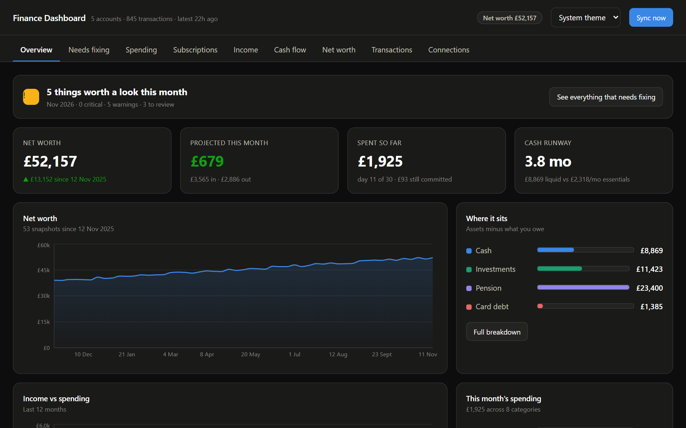
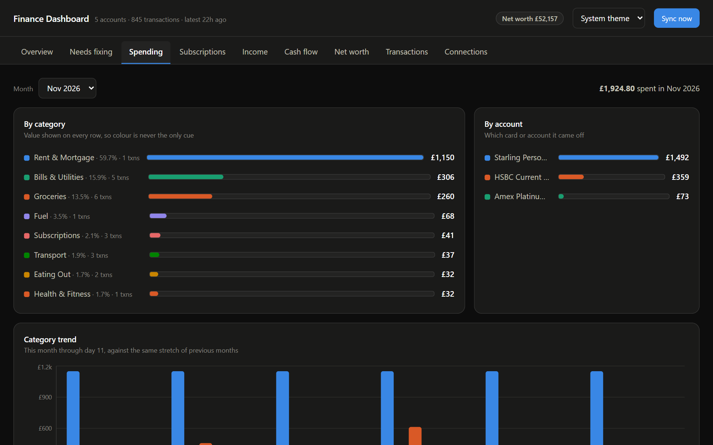
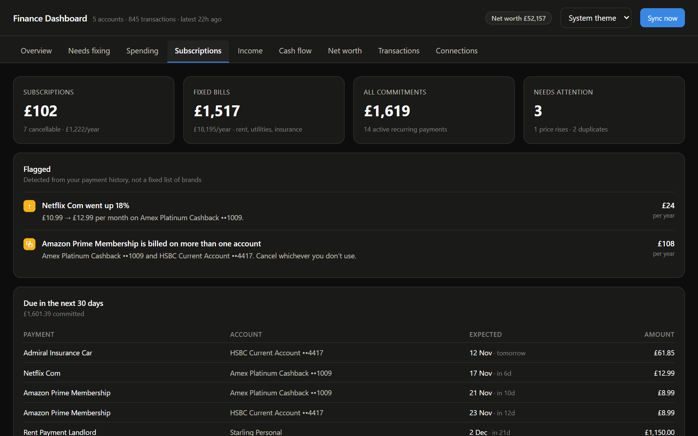
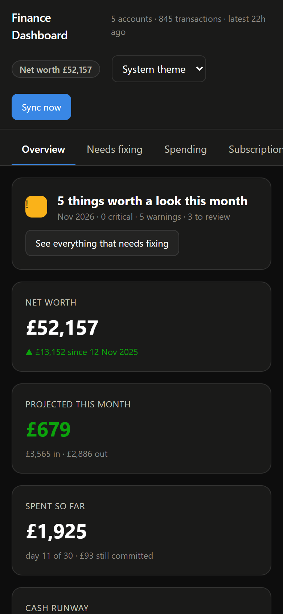
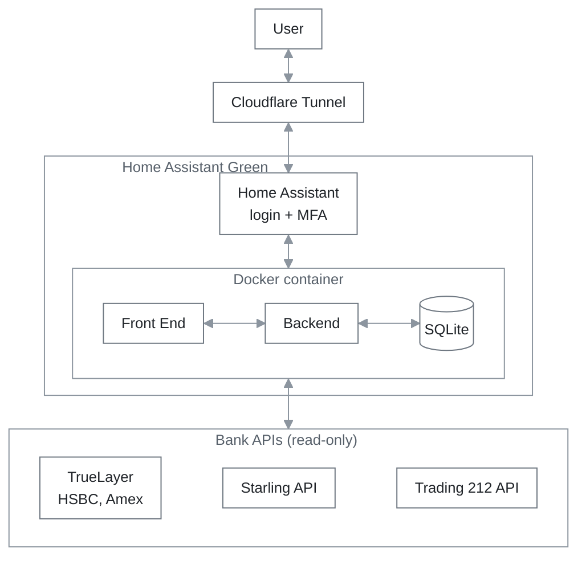

<div align="center">

# Finance Dashboard

**Spending, budgets, subscriptions and net worth across your own accounts,
in the Home Assistant sidebar.**

[](https://github.com/H-Ali1/finance-dashboard/tags)
[](https://github.com/H-Ali1/finance-dashboard/actions/workflows/ci.yml)
[](homeassistant/DOCS.md)
[](#requirements)
[](LICENSE)
[](https://buymeacoffee.com/hali1)

[](https://my.home-assistant.io/redirect/supervisor_add_addon_repository/?repository_url=https%3A%2F%2Fgithub.com%2FH-Ali1%2Ffinance-dashboard%23ha-release)

[Features](#features) · [Installation](#installation) · [Connected accounts](#connected-accounts) · [Architecture](#architecture) · [Security](#security) · [FAQ](#faq) · [Development](#development)

</div>

---

A vibe-coded personal finance dashboard, built to replace Emma and Snoop. It
brings bank accounts, credit cards and investments together in one place, for
insight into spending, budgeting and investments. It's self-hosted at home on
a Home Assistant Green, a small Raspberry Pi, and installs like any other Home
Assistant App.

<p align="center">
  
</p>

## Features

- ✅ **Spending:** where the money goes, by category and merchant, month by month
- ✅ **Budgets:** monthly limits per category, and how this month is tracking
- ✅ **Subscriptions and bills:** found automatically, with price rises,
  duplicates and stopped payments flagged
- ✅ **Cash flow:** money in against money out, and a projection for the month
- ✅ **Investments and net worth:** Trading 212 holdings, the pension and other
  assets, and a daily net-worth history
- ✅ **Needs fixing:** plain-English findings, each with a pound figure attached
- ✅ **Read-only everywhere:** no connection can move money
- ✅ **Your data stays at home,** in a database on your own Home Assistant
- ✅ **Behind Home Assistant's login,** with its multi-factor authentication
- ✅ **Daily backups** kept for a week, and statement import for banks without
  an API

<table>
  <tr>
    <td width="50%"></td>
    <td width="50%"></td>
  </tr>
  <tr>
    <td align="center">Spending by category and account</td>
    <td align="center">Subscriptions, price rises and duplicates</td>
  </tr>
</table>

On a phone, the cards stack into one column:

<p align="center">
  
</p>

<sub>Screenshots use made-up demo data.</sub>

## Installation

### Requirements

- Home Assistant OS or Home Assistant Supervised. Apps need the Supervisor,
  so Home Assistant Container and Core installs can use
  [Docker Compose](#docker-compose) instead.
- A 64-bit ARM (`aarch64`) or Intel/AMD (`amd64`) machine. Images are prebuilt
  for both.

### Home Assistant

1. Press **Add repository to my Home Assistant** above, or add this under
   **Settings → Apps → App store → ⋮ → Repositories**:

   ```
   https://github.com/H-Ali1/finance-dashboard#ha-release
   ```

2. Open **Finance Dashboard** in the App store and press **Install**.
3. Add your keys on the **Configuration** tab. On the **Info** tab, turn on
   **Start on boot**, **Watchdog**, **Auto update** and **Show in sidebar**,
   then press **Start**.

The full setup guide, including connecting banks through TrueLayer, is in
[homeassistant/DOCS.md](homeassistant/DOCS.md).

> [!NOTE]
> Finance Dashboard isn't in HACS. HACS distributes integrations, dashboard
> cards and themes, not Apps. The repository button above is the one-click
> equivalent.

### Docker Compose

Copy `backend/.env.example` to `backend/.env` and add your keys first: the
container reads them when it starts. Then:

```bash
docker compose up -d --build
```

Open http://127.0.0.1:8099. It only listens on localhost, because the app has
no login of its own. After changing `backend/.env`, run
`docker compose up -d --force-recreate` to start again with the new keys.

## Connected accounts

| Account | How |
|---|---|
| Starling | Starling's API, with a read-only personal access token |
| Trading 212 | Trading 212's API, with a read-only key |
| HSBC, Amex and other UK banks | TrueLayer (open banking) |
| Anything else | CSV statement import |

## Architecture



Home Assistant OS runs everything as Docker containers, and the dashboard is
one of them, installed as a Home Assistant App. Inside it, a single Python
process does all the work:

| Part | Built with | Job |
|---|---|---|
| Backend | Python 3.12, FastAPI | The JSON API, and serves the web UI |
| Frontend | React, TypeScript, Vite, Recharts | The tabs and charts in the browser |
| Database | SQLite in the `/data` volume | Accounts, transactions, budgets, history |
| Background jobs | A thread in the same process | Syncs every few hours, backs up daily |

### How data flows

**Syncing** runs on a schedule (every 6 hours), from the Sync button, or when a
bank is connected. Only one sync runs at a time.

1. Fetch accounts, balances and transactions from each provider.
2. Store them in one format: amounts in pence, money out negative. Rows
   already stored are updated rather than added twice.
3. Categorise each transaction: your own rules first, then keywords, the
   card's merchant code, then the bank's own category.
4. Pair transfers between your own accounts, so paying off a credit card isn't
   counted as spending and income.
5. Record the day's net worth.

**Viewing:** each tab asks the API for what it shows. Nothing is calculated in
advance: the figures are worked out from the database on every request, then
drawn as charts in the browser.

## Security

- **Remote access through a Cloudflare Tunnel.** The Cloudflared add-on opens
  an outbound tunnel to Cloudflare, so no port is open on the home router.
- **Home Assistant's login, with multi-factor authentication.** The dashboard
  has no login of its own: it sits behind Home Assistant's, and only admin
  accounts see it.
- **No open port.** The container publishes no port. Requests only arrive
  through Home Assistant's ingress proxy, and the app refuses any connection
  that comes from anywhere else.
- **Read-only access everywhere.** The Starling token, Trading 212 key and
  TrueLayer connections can read data but can't move money.
- **Keys stay on the device.** They're stored in the App's private `/data`
  folder, never sent to the browser, and never committed: `.env` files and
  databases are excluded from the repository and the image.
- **Encrypted backups.** Home Assistant backups include the database and the
  keys, so backup encryption stays on.
- **Trade-offs to know about:**
    - The App updates itself from this repository, so the GitHub account is
      protected with two-factor authentication.
    - HSBC and Amex data passes through TrueLayer on its way to the dashboard.

## FAQ

**Is my data sent anywhere?** It's stored in the App's database on your Home
Assistant, with a daily copy of it kept there for a week. Home Assistant's own
backups include the database too, so it also goes wherever you store those
backups: keep backup encryption on. The app talks to Starling, Trading 212 and
TrueLayer to fetch your accounts, and to nothing else: there's no analytics or
tracking. HSBC and Amex data passes through TrueLayer on its way to you.

**Why do HSBC and Amex need connecting again every 90 days?** Open banking
access lasts 90 days. **Needs fixing** warns you in the last 10 days: press
**Connect again** on the **Connections** tab and approve it at your bank.

**Can I add Chase or another bank?** If TrueLayer supports your bank, connect
it on the **Connections** tab. Otherwise, import its statements as CSV files
with a date, a description and an amount. Chase UK isn't on TrueLayer and only
gives PDF statements, so convert those to CSV first. Rows you've already
imported are skipped, so importing a statement again, or one that overlaps
another, is safe. The one catch: identical transactions on the same day (same
amount and description) are told apart by their order in the file, so import
statements that cover whole days.

**What if TrueLayer stops letting me connect?** TrueLayer only signs contracts
with businesses, and personal use of a Live app isn't supported, so it could
stop at any time. Starling, Trading 212 and CSV import don't depend on it.

**Can it move money or make payments?** No. Every connection is read-only:
the Starling token, the Trading 212 key and the TrueLayer access can read
balances and transactions, nothing more.

## Development

Run it locally with demo data:

```bash
cd backend && python -m venv .venv && .venv/Scripts/pip install -r requirements.txt
```

```bash
cd backend && .venv/Scripts/python seed_demo.py --reset
```

```bash
cd backend && .venv/Scripts/python -m uvicorn app.main:app --reload
```

```bash
cd frontend && npm install && npm run dev
```

Then open http://localhost:5173. On macOS and Linux the paths are `.venv/bin/`
instead of `.venv/Scripts/`.

Changes go in through pull requests: tests, lint, a secret scan and a
CodeRabbit review must pass before one merges. Merging a change to the app
into `main` releases it to Home Assistant; documentation-only changes don't. See [CONTRIBUTING.md](CONTRIBUTING.md).

### Project layout

```
backend/
  app/
    providers/    Starling, Trading 212, TrueLayer, CSV import
    services/     sync, categories, transfers, scheduler, backups
    analytics/    spending, subscriptions, cash flow, net worth, insights
    routers/      the API
  tests/
frontend/src/     the React app
homeassistant/    the Home Assistant App definition and its docs
Dockerfile        one image for Home Assistant, Docker and Kubernetes
```

## Licence

Released under the [MIT License](LICENSE).

## Disclaimer

Finance Dashboard isn't affiliated with Home Assistant, Starling, Trading 212,
TrueLayer or any bank, and nothing it shows is financial advice.

## Support

If Finance Dashboard helps you keep on top of your money, you can buy me a
coffee. Thank you! ☕

<a href="https://buymeacoffee.com/hali1"></a>
